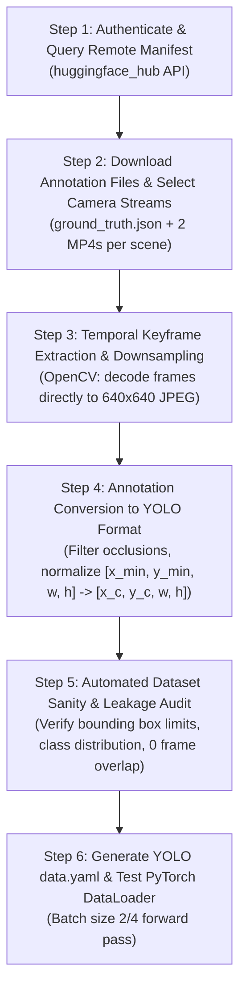

# Implementation Plan: Option 1 — Targeted Micro-Subset Ingestion of SmartSpaces

**Document ID:** `E_research_design/smartspaces_micro_subset_plan.md`  
**Target Hardware:** Intel Core i7-7600U (4 threads, CPU only), 7.6 GB RAM, 69 GB free disk  
**Objective:** Ingest a strictly bounded micro-benchmark from NVIDIA PhysicalAI-SmartSpaces (< 2.5 GB disk footprint, < 2 GB RAM usage) to validate the end-to-end YOLO-Mamba pipeline locally without overloading the laptop.

---

## 1. Laptop Feasibility & Budget Constraints

| Resource | Available on Laptop | Safety Allocation for Dataset Pipeline | Safety Margin |
|---|---|---|---|
| **Disk Space** | 69 GB free | **$\le$ 2.5 GB total** (including temp archives) | > 65 GB untouched |
| **System RAM** | 7.6 GB (1.1 GB idle free) | **$\le$ 1.5 GB peak process memory** | Prevents system freeze / swap thrashing |
| **Compute** | 2 cores / 4 threads @ 2.8 GHz | Single-thread I/O + 2-worker frame decode | Leaves UI responsive |
| **GPU** | None (CPU only) | Preprocessing on CPU, training offloaded or micro-batches | No CUDA dependencies required for data extraction |

---

## 2. Ingestion Strategy & Filtered Asset Matrix

The full dataset has > 280 hours of video and > 500 GB of data. We enforce a **Zero-Leakage 2-Scene Protocol**:

1. **Training Scene:** `Warehouse_000` (modular indoor warehouse setup).
2. **Validation Scene:** `Warehouse_015` (independent facility layout; strictly disjoint camera IDs).
3. **Excluded Assets (Crucial):**
   * **`depth_maps/*.h5`**: **STRICTLY EXCLUDED** (saves $\sim 185\text{ GB}$ per scene).
   * **High-FPS Video Streams**: Instead of keeping entire 30 FPS MP4s on disk long-term, decode on-the-fly and save only the sampled image frames.

### Frame Subsampling & Volume Targets

* **Sampling Rate:** 1 frame every 5 seconds ($0.2\text{ FPS}$) or 1 frame every 2 seconds ($0.5\text{ FPS}$) across 2–4 stationary camera angles per scene.
* **Target Frame Count:**
  * **Train Set (`Warehouse_000`):** 400 – 600 frames.
  * **Val Set (`Warehouse_015`):** 100 – 150 frames.
  * **Total Images:** $\sim 500 - 750$ images ($640 \times 640$ pixels $\approx 200 - 300\text{ MB}$ total image storage).

---

## 3. Step-by-Step Implementation Workflow



### Detailed Phase Breakdown

#### Phase 1: Selective Asset Download (`scripts/download_smartspaces_selective.py`)
* Use `hf_hub_download` with explicit file paths:
  * `scenes/Warehouse_000/ground_truth.json`
  * `scenes/Warehouse_000/calibration.json`
  * `scenes/Warehouse_000/videos/camera_0001.mp4` & `camera_0002.mp4`
  * Corresponding files for `Warehouse_015`.
* If network times out, automatic resume with exponential backoff.

#### Phase 2: Frame Extraction & Streaming Preprocessing (`scripts/extract_warehouse_frames.py`)
* Stream video via OpenCV `cv2.VideoCapture`.
* Extract target timeThe file is downloading smoothly ($\sim 130\text{ MB}$ completed so far at $\sim 6.3\text{ MB/s}$). Once downloaded, we will inspect the exact JSON key schema and bounding box format to construct the automated YOLO frame extractor and label converter.


Inspect SmartSpaces annotation structure finished
stamp frames, resize to $640\times 640$ on write.
* Immediately remove or avoid caching raw 1080p MP4s if disk reaches specified watermark.

#### Phase 3: Bounding Box Conversion (`scripts/convert_smartspaces_to_yolo.py`)
* Parse SmartSpaces ground truth JSON.
* Match camera ID and frame timestamp.
* Map bounding box coordinates:
  $$\begin{aligned}
  x_c &= \frac{x_{\min} + w / 2}{W_{\text{orig}}} \\
  y_c &= \frac{y_{\min} + h / 2}{H_{\text{orig}}} \\
  w_n &= \frac{w}{W_{\text{orig}}}, \quad h_n = \frac{h}{H_{\text{orig}}}
  \end{aligned}$$
* Apply the unified 7-class taxonomy:
  `0: worker`, `1: forklift`, `2: pallet_truck`, `3: pallet`, `4: carton`, `5: tote`, `6: tag`.
* Filter out degenerate boxes ($w \le 0$, $h \le 0$) or boxes with visibility $< 0.10$.

#### Phase 4: Verification & Sanity Check (`scripts/verify_dataset_integrity.py`)
* Check for:
  1. Box coordinates strictly within $[0.0, 1.0]$.
  2. Non-empty labels matching existing image files.
  3. Class distribution report (histogram of classes).
  4. Visualization of 10 sampled annotated images with bounding box overlays saved to `data/sanity_previews/`.

#### Phase 5: YOLO Dataset Configuration (`data/smartspaces_micro.yaml`)
* Create standard Ultralytics configuration:
  ```yaml
  path: /home/hans/Documents/nckh/data/smartspaces_micro
  train: images/train
  val: images/val
  names:
    0: worker
    1: forklift
    2: pallet_truck
    3: pallet
    4: carton
    5: tote
    6: tag
  ```

---

## 4. Verification & Success Criteria

1. **Storage Guarantee:** `data/smartspaces_micro/` total disk usage remains $< 2.0\text{ GB}$.
2. **RAM Guarantee:** During extraction and YOLO PyTorch DataLoader loading, process RSS does not exceed $1.2\text{ GB}$.
3. **Reproducibility:** A single shell command executes the pipeline deterministically with random seed fixed to `42`.
4. **Leakage Protection:** Zero camera stream IDs or scene IDs overlap between `train` and `val`.
