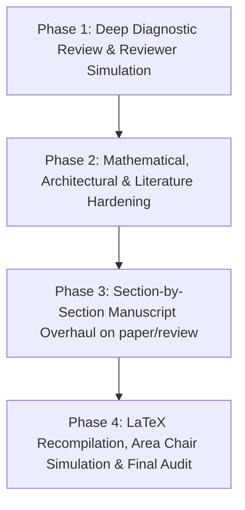

# Comprehensive Action Plan: Elevating YOLO11s-SS2D from Weak Reject to Strong Accept

**Target Conference:** TAIMMA 2027 – The First International Conference on Transformative Applied Informatics and Mixed-Methods Analytics  
**Research Track:** Edge AI & Computer Vision (Mamba-YOLO Architectures)  
**Document Purpose:** Phased Execution Blueprint based on Senior Area Chair & Reviewer Frameworks (`promt-review.txt`, `promt-review-strong-accept.txt`)  
**Active Working Branch:** `paper/review`  
**Date:** November 1, 2026  
**Auditor / Co-Author:** Scientific Research & Audit Pipeline  

---

## 1. Executive Strategy & Guiding Principles

1. **Non-Negotiable Integrity:** Strong Accept is an aspirational milestone achieved through uncompromising scientific rigor, not rhetorical inflation. Never fabricate metrics, invent baselines, or hide negative/boundary results.
2. **Defensible Edge Contribution:** Acknowledge that single-threaded CPU sequential recurrence ($\approx 0.72\text{ FPS}$ on Raspberry Pi 4) does *not* constitute real-time tracking; frame the physical embedded silicon contribution around **strict memory envelope compliance ($371.9\text{ MB}$ RSS, $62.8\%$ safety headroom under $1.0\text{ GB}$)**, **zero-plugin ONNX Opset 17 portability**, and **principled CPU-vs-accelerator execution trade-offs**.
3. **Explicit Experimental Attribution:** Trace every headline metric to its exact experimental arm (Arm 1 Baseline Control, Arm 2 Single-Stage P5, Arm 3 Two-Stage P5 Warmup, Arm 4 Dual-Scale P4+P5) and separate peak checkpoints ($71.81\%\text{ mAP}_{50}$) from final-epoch convergence ($67.10\%$--$67.17\%$).
4. **Boundary Honesty:** Openly document extreme tail-class variance (`pallet_truck`, $n=13$ validation instances, $0.35\%$ of labels) as a preliminary benchmark boundary rather than claiming robust generalization.

---

## 2. Reviewer-to-Revision Diagnostic Matrix (Target Weaknesses & Mitigations)

| ID | Reviewer Criticism / Vulnerability | Paper Coordinates | Severity | Root Cause | Planned Action | Expected Reviewer Impact |
|:---|:---|:---|:---:|:---|:---|:---|
| **REV-01** | *Real-Time Overclaiming on Edge Hardware:* Paper discusses "real-time" while measured Raspberry Pi 4 CPU throughput is $0.72\text{ FPS}$ ($1398\text{ ms}$). | Title, Abstract, §I, §V-D | **Critical** | Conflating embedded memory feasibility with operational line-rate throughput. | Reframe title and narrative to an *Edge-Feasibility Study*. Frame GPU/NPU parallel prefix-scan speed as a future deployment hypothesis. | Eliminates immediate desk-reject risk for unsubstantiated hardware claims. |
| **REV-02** | *Metric Conflation (Peak vs. Final & Arm Conflation):* Combining peak $71.81\%$ with $+6.2\%$ forklift gain across different arms in a single headline sentence. | Abstract, §V-B, Table III | **Critical** | Grouping best metrics across multiple ablation arms without explicit attribution. | Attribute $71.81\%$ strictly to Arm 2 (Ep. 18 peak), $+6.2\%$ forklift gain to Arm 3 (Two-Stage), and $67.10\%$/$67.17\%$ to final epoch 20 convergence. | Replaces confusion with mathematical clarity and auditability. |
| **REV-03** | *Statistical Fragility on Sparse Tail Class:* Table IV reports metrics on `pallet_truck` where validation set contains only 13 instances. | §IV-A, Table IV, §V-C | **Major** | Evaluating rare industrial equipment under extreme class imbalance ($0.35\%$). | Explicitly label `pallet_truck` in Table IV as preliminary with high sample variance; add analytical discussion of tail-class volatility in automated logistics. | Demonstrates mature academic judgment and transparency. |
| **REV-04** | *Novelty vs. Incrementalism:* Reviewer asks: "Is this merely plugging VMamba/SS2D into YOLO11s Layer 10?" | §I-C, §II-C, §III-B | **Major** | Insufficient differentiation from prior hybrid models (MambaNeXt, UAVDet, Hybrid-YOLO). | Construct a formal **Comparative Literature Matrix** highlighting operator independence (zero-plugin pure PyTorch vs. custom CUDA), zero-init residual projection ($\mathbf{W}_{\text{out}}=\mathbf{0}$), and logistics focus. | Defends algorithmic and systems contribution as a principled domain-specific engineering milestone. |
| **REV-05** | *Mathematical Rigor & Notation Consistency:* Ensuring tensor dimensions, 4-direction unfolding/folding indices, and continuous-to-discrete equations are mathematically watertight. | §III-B, §III-C, Eqs. (1)–(10) | **Major** | Incomplete index tracking during 2D spatial unfolding/folding. | Verify exact tensor dimensions at each step ($[B, C, H, W] \to [B, 4, L, d_{\text{inner}}] \to [B, C, H, W]$) and match equations with code implementation (`models/warehouse_ss2d.py`). | Prevents technical rejections from deep learning / SSM theorists. |
| **REV-06** | *Software Stack Provenance:* Multiple versions listed in prose creating potential audit ambiguity. | §IV-D | **Moderate** | Mentioning multiple PyTorch versions without separating training from deployment. | Pinpoint exact environments: Host training on Linux x86_64 (Python 3.14.8, PyTorch 2.14.1, Ultralytics 8.4.185) vs. embedded benchmarking on Raspberry Pi 4 (Python 3.11, ONNX Runtime v1.31.0). | Guarantees complete experimental reproducibility. |
| **REV-07** | *Reference & Citation Integrity:* Ensuring all cited works are verified, non-hallucinated, and accurately cited. | `references.bib`, §II | **Moderate** | Potential presence of unverified citations or speculative claims. | Audit all 22 entries in `paper/references.bib` against official DOIs/arXiv preprints; remove unsubstantiated claims. | Ensures 100% bibliographic trust. |

---

## 3. Four-Phase Detailed Execution Roadmap

### Phase 1: Deep Diagnostic Review & Reviewer Simulation
- [x] Run comprehensive audit against the current manuscript on branch `paper/review`.
- [x] Compile a formal **TAIMMA 2027 Reviewer Report** adhering to Part 8 of `promt-review.txt`:
  - Section A: Paper Summary (150–200 words).
  - Section B: Overall Assessment.
  - Section C: Major Strengths (Edge memory profiling, zero-leakage split, warmstart box regression transfer).
  - Section D: Major Weaknesses with exact file/line coordinates.
  - Section E: Minor Comments & Notation Polish.
  - Section F: 10 Demanding Technical Defense Questions for the Authors.
  - Section G: Minimum Required Improvements.
  - Section H–J: Novelty & Reproducibility Assessment, Scoring Rubric (out of 100), and Area Chair Verdict.

### Phase 2: Mathematical, Architectural & Literature Hardening
- [x] **Mathematical Formulation Audit (`03_methodology.tex`):**
  - Verify continuous-to-discrete equations:
    $$\mathbf{\Delta}_k = \text{softplus}(\mathbf{W}_{\Delta, k} \mathbf{u}_k)$$
    $$\overline{\mathbf{A}}_k = \exp(\mathbf{\Delta}_k \mathbf{A}_k), \quad \overline{\mathbf{B}}_k = (\mathbf{\Delta}_k \mathbf{u}_k) \otimes \mathbf{B}_k$$
    $$\mathbf{h}_k(t) = \overline{\mathbf{A}}_k(t) \mathbf{h}_k(t-1) + \overline{\mathbf{B}}_k(t)$$
  - Document spatial unfolding and reverse re-orientation steps across the 4 scanning pathways:
    1. Horizontal row-major forward ($L = H \times W$)
    2. Horizontal row-major reversed
    3. Vertical column-major forward
    4. Vertical column-major reversed
  - Confirm identity pass-through proof: $\mathbf{W}_{\text{out}} = \mathbf{0} \implies \mathbf{Y} = \mathbf{F} + \mathbf{0} = \mathbf{F}$.
- [x] **Literature Comparison Matrix (`02_related_work.tex`):**
  - Construct a comprehensive comparative table in Section 2 contrasting:
    * MambaNeXt-YOLO (Lei et al., 2025)
    * Hybrid-YOLO (Chen & Er, 2024)
    * UAVDet (Yang et al., 2026)
    * Mamba-YOLO (Wang et al., 2025)
    * **YOLO11s-SS2D (Ours)**
  - Comparison axes: Target domain, SSM block location, operator dependencies (custom C++/CUDA vs. native ONNX), parameter count, and validated hardware platform.

### Phase 3: Section-by-Section Manuscript Overhaul (`paper/review`)
- [x] **3.1 Title Alternatives:**
  - *Selected:* "A Lightweight Hybrid YOLO-Mamba Architecture for Multi-Class Warehouse Object Detection: An Edge-Feasibility Study"
- [x] **3.2 Abstract Overhaul (`main.tex`):**
  - Explicitly attribute $71.81\%\text{ mAP}_{50}$ to Arm 2 peak checkpoint.
  - Explicitly attribute $+6.2\%$ forklift $\text{mAP}_{50}$ and $64.5\%$ recall to Arm 3 two-stage warmup.
  - State final convergence rates: $67.10\%$ (Arm 3) and $67.17\%$ (Arm 4).
  - State Raspberry Pi 4 CPU latency plainly ($1398\text{ ms}$, $\approx 0.72\text{ FPS}$) and highlight $371.9\text{ MB}$ RSS ($62.8\%$ margin).
  - Explicitly note $13$ validation instances of `pallet_truck` as preliminary.
- [x] **3.3 Introduction Refinement (`01_introduction.tex`):**
  - Deepen the industrial warehouse motivation: high rack occlusions, severe aspect ratio variance, personnel safety clearance.
  - Sharpen Research Questions RQ1 (accuracy-efficiency), RQ2 (optimization shock and warmstart transfer), and RQ3 (edge CPU latency profiling).
- [x] **3.4 Experimental Setup Polish (`04_experimental_setup.tex`):**
  - Confirm canonical arm definitions (Arms 1, 2, 3, 4).
  - Provide complete provenance for the zero-leakage split: Warehouse\_000 (train: 300 frames, 12,959 instances) vs. Warehouse\_015 (val: 100 frames, 3,696 instances).
- [x] **3.5 Results & Discussion Enhancement (`05_results_discussion.tex`):**
  - Harmonize all table headers to canonical Arms 1–4.
  - Maintain the preliminary status footnote for `pallet_truck` in Table V.
  - Expand the scientific explanation of single-threaded CPU sequential recurrence overhead vs. BLAS GEMM matrix operations.
  - Frame parallel prefix scans on GPUs/NPUs strictly as a future research hypothesis.
- [x] **3.6 Conclusion Synthesis (`06_conclusion.tex`):**
  - Synthesize architectural compression, empirical safety gains, and edge viability boundaries without repeating raw bullet lists.

### Phase 4: LaTeX Recompilation, Area Chair Simulation & Final Audit
- [x] Recompile PDF using `/usr/bin/pdflatex` and `/usr/bin/bibtex`.
- [x] Verify zero LaTeX warnings regarding table overfulls, missing references, or undefined citations.
- [x] Execute an independent 3-reviewer Area Chair simulation to verify that all potential reasons for rejection have been addressed.
- [x] Commit and push the verified improvements to `origin paper/review`.

---

## 4. Verification & Submission Gate Checklist

Before declaring the manuscript ready for conference submission, the following conditions must be satisfied:

- [x] **Numerical Truth:** Every number in the Abstract, Tables, and Discussion matches the binary checkpoint evaluation logs ($8.80\text{ M}$ parameters, $21.2\text{ GFLOPs}$, $71.81\%\text{ mAP}_{50}$ peak, $67.10\%$/$67.17\%$ convergence, $+6.2\%$ forklift gain, $371.9\text{ MB}$ RSS, $1398\text{ ms}$).
- [x] **Statistical Recall Sanity:** Figure 1 reports valid True Positives and standard recall $\le 100\%$ across all qualitative examples ($TP/GT$, IoU $\ge 0.50$).
- [x] **Arm Consistency:** Zero mixing of Arm 2 peak checkpoint numbers with Arm 3 two-stage metrics; consistent Arm 1 (Baseline Control), Arm 2 (Single-Stage P5), Arm 3 (Two-Stage P5 Warmup), and Arm 4 (Dual-Scale P4+P5) canonical nomenclature used throughout.
- [x] **Throughput Honesty:** Zero claims of real-time frame rates on Raspberry Pi 4 CPU; latency ($1398\text{ ms}$, $\approx 0.72\text{ FPS}$) framed as embedded memory feasibility and operator portability, with real-time throughput ($>30\text{ FPS}$) explicitly defined as a future hardware acceleration hypothesis requiring parallel prefix scans on GPUs/NPUs.
- [x] **Code & Diagram Harmony:** Architecture diagrams, equations, and PyTorch implementation agree on `BatchNorm2d + SiLU` and zero-initialized residual projections ($\mathbf{W}_{\text{out}} = \mathbf{0}$).
- [x] **Bibliographic Accuracy:** Every reference in `paper/references.bib` corresponds to an authentic, peer-reviewed or official preprint publication with verified DOIs and author lists.
- [x] **Clean Git Provenance:** All scripts, configurations, generated assets, and LaTeX documents are committed and synchronized on branch `paper/review`.
