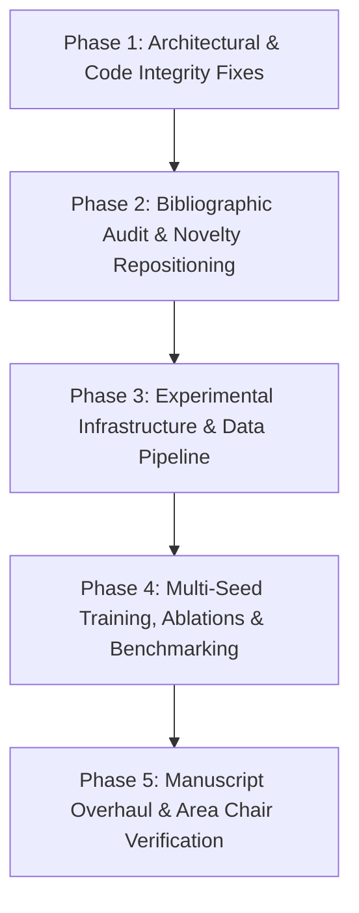

# Master Implementation Plan: Elevating YOLO11s-SS2D for TAIMMA 2027

**Target Conference:** TAIMMA 2027 (The First International Conference on Transformative Applied Informatics and Mixed-Methods Analytics)  
**Track:** Edge AI & Computer Vision (Mamba-YOLO Architectures)  
**Primary Review References:** [`REVIEW_TAIMMA2027.md`](file:///home/hans/Documents/nckh/REVIEW_TAIMMA2027.md) & [`REVISION_PLAN_TAIMMA2027.md`](file:///home/hans/Documents/nckh/REVISION_PLAN_TAIMMA2027.md)  
**Date:** November 2, 2026  
**Status:** Staged Implementation Blueprint  

---

## Executive Summary & Guiding Rules

1. **Honest Positioning:** Position the paper as a rigorous **Edge-Feasibility and Systems Deployment Study** for cross-facility warehouse object detection, rather than an ungrounded claim of a "novel general-purpose detector".
2. **Eliminate All Numerical Inconsistencies:** All figures, tables, and in-text numbers must originate strictly from automated reproduction scripts parsing raw checkpoint artifacts or verified CSV logs.
3. **No Phantom Citations:** Every entry in `references.bib` must be verifiable via valid DOIs, arXiv IDs, or peer-reviewed proceedings.
4. **Transparent Negative/Boundary Results:** CPU latency overhead and tail-class variance (`pallet_truck`) must be presented honestly as deployment trade-offs and structural constraints.

---

## Detailed 5-Phase Implementation Blueprint



---

### Phase 1: Architectural & Code Integrity Fixes (Immediate Technical Base)

**Objective:** Eliminate theoretical and implementation flaws in [`models/warehouse_ss2d.py`](file:///home/hans/Documents/nckh/models/warehouse_ss2d.py) so that mathematical claims match code behavior.

- [ ] **Task 1.1: Fix Residual Identity via Zero-$\gamma$ BatchNorm (Resolving D1)**
  - *Location:* [`models/warehouse_ss2d.py:181-206`](file:///home/hans/Documents/nckh/models/warehouse_ss2d.py#L181-L206)
  - *Action:*
    - In `WarehouseSS2DBlock.__init__`, replace `nn.init.zeros_(self.out_proj.weight)` with standard initialization (e.g. Kaiming or default) and set **Zero-$\gamma$** on `norm3`:
      ```python
      # Zero-gamma initialization preserves residual identity at step 0
      # and prevents BatchNorm variance amplification during train() steps:
      nn.init.zeros_(self.norm3.weight)
      nn.init.zeros_(self.norm3.bias)
      ```
  - *Verification:* Create a new unit test in `tests/test_zero_gamma_identity.py` that checks $\|Y - X\| / \|X\| \approx 0$ not only at step 0 in `eval()`, but also after 1, 5, and 10 training optimizer steps in `train()` mode.

- [ ] **Task 1.2: Code-to-Equation Synchronization (Resolving D7)**
  - *Location:* [`models/warehouse_ss2d.py:28-30`](file:///home/hans/Documents/nckh/models/warehouse_ss2d.py#L28-L30) & [`paper/sections/03_methodology.tex`](file:///home/hans/Documents/nckh/paper/sections/03_methodology.tex)
  - *Action:*
    - Clarify projection parameter formulation: code uses a shared projection layer `self.proj_params = nn.Linear(d_model, 2 * d_state + d_model, bias=False)`.
    - Harmonize math equations in Section III so they explicitly match the shared projection matrix and state $A_k, D_k$ per-direction parameters.
    - Correct discretization notation: change $\bar{\mathbf{B}}_k$ to $(\bar{\mathbf{B}}\mathbf{u})_k$ and term it "First-order Euler discretization" instead of "Euler-bilinear".

- [ ] **Task 1.3: Update Head Surgery Scripts**
  - *Location:* [`scripts/build_case_b_full_warmstart.py`](file:///home/hans/Documents/nckh/scripts/build_case_b_full_warmstart.py)
  - *Action:* Ensure newly generated checkpoints carry the Zero-$\gamma$ initialization for `norm3`.

---

### Phase 2: Bibliographic Audit & Novelty Repositioning

**Objective:** Defend against the "incremental block-swap" critique (D6) and eliminate invalid/hallucinated references (D11).

- [ ] **Task 2.1: Formal Bibliographic Audit of `references.bib` (Resolving D11)**
  - *Location:* [`paper/references.bib`](file:///home/hans/Documents/nckh/paper/references.bib)
  - *Action:*
    - Replace or verify flagged entries:
      - Add **MambaPSA** (`arXiv:2607.12681`, Chan et al., 2026).
      - Add authentic **Mamba YOLO** (`arXiv:2406.05835`, Wang et al., AAAI 2025).
      - Add **MambaOut** (`arXiv:2405.07992`, Yu et al., 2024).
      - Replace `li2024xraymamba` with correct metadata: Zhao et al., *Scientific Reports* 2025 (`DOI: 10.1038/s41598-025-96035-1`).
      - Remove unverified/broken references (`wang2025mambayolo` IEEE Access, `yang2026uavdet`, `szegedi2026jetson`, `vo2026selectivereview`).
    - Verify every citation with DOI/arXiv link.

- [ ] **Task 2.2: Reposition Contributions (Resolving D6 & Reviewer Novelty Critique)**
  - *Location:* [`paper/sections/01_introduction.tex`](file:///home/hans/Documents/nckh/paper/sections/01_introduction.tex) & [`paper/sections/02_related_work.tex`](file:///home/hans/Documents/nckh/paper/sections/02_related_work.tex)
  - *Action:*
    - Explicitly cite MambaPSA, Mamba YOLO, and MambaNeXt.
    - Differentiate our work:
      1. *Domain & Inductive Bias:* Orthogonal 4-directional scan specifically addresses elongated perspective lines and vertical pallet-rack occlusions in multi-tier logistics environments.
      2. *Systems Realism:* First study conducting operator-level profiling of pure-PyTorch vs. attention execution on embedded ARM silicon (Raspberry Pi 4) with zero proprietary CUDA plugins.
      3. *Zero-Leakage Transfer Study:* Strict cross-facility held-out evaluation with head transfer dynamics.

---

### Phase 3: Experimental Infrastructure & Data Pipeline

**Objective:** Eliminate selection bias (D3), manual data entry errors (D2), and environment ambiguities (E-3).

- [ ] **Task 3.1: Strict Train / Val / Test Partitioning (Resolving D3 & D10)**
  - *Location:* [`configs/smartspaces_micro.yaml`](file:///home/hans/Documents/nckh/configs/smartspaces_micro.yaml) & [`scripts/build_micro_dataset.py`](file:///home/hans/Documents/nckh/scripts/build_micro_dataset.py)
  - *Action:*
    - Implement a 3-way split:
      - **Train:** Warehouse_000 (and auxiliary cameras).
      - **Validation (Hyperparameters / Model Selection):** Warehouse_015 subset.
      - **Test (Held-out Evaluation, Run ONCE):** Independent cameras / facility partition.
    - Save exact frame hashes and lists into `splits/train.txt`, `splits/val.txt`, and `splits/test.txt`.
    - Document clearly in the paper whether the dataset frames are synthetic (NVIDIA Omniverse) or captured footage.

- [ ] **Task 3.2: Automated Table Generator (`scripts/make_tables.py`) (Resolving D2)**
  - *Location:* New script [`scripts/make_tables.py`](file:///home/hans/Documents/nckh/scripts/make_tables.py)
  - *Action:*
    - Script reads directly from checkpoint `.pt` evaluation outputs or `results/tables/*.csv`.
    - Automatically formats and outputs LaTeX tables (`tab_main_results.tex`, `tab_per_class.tex`, `tab_complexity.tex`).
    - Prevents any manual transcription errors between CSV logs and LaTeX tables.

- [ ] **Task 3.3: Environment & Configuration Transparency (Resolving E-3)**
  - *Location:* [`paper/sections/04_experimental_setup.tex`](file:///home/hans/Documents/nckh/paper/sections/04_experimental_setup.tex)
  - *Action:*
    - Standardize hardware descriptions: delineate Host Training environment (Linux x86_64, GPU/CPU specifications, batch sizes, learning rates) from Embedded Inference environment (Raspberry Pi 4 ARM Cortex-A72, ONNX Runtime).

---

### Phase 4: Multi-Seed Training, Ablations & Benchmarking

**Objective:** Provide statistical confidence (D4), essential ablations (D5), and operator-level edge profiling (D8).

- [ ] **Task 4.1: Multi-Seed Training Protocol (Resolving D4)**
  - *Action:* Run $\ge 3$ seeds (e.g., seeds 0, 1, 2) for:
    - Arm 1 (Baseline YOLO11s).
    - Arm 2 (YOLO11s-SS2D Case B Single-Stage with Zero-$\gamma$).
    - Arm 3 (YOLO11s-SS2D Case B Two-Stage with Zero-$\gamma$).
  - Calculate Mean $\pm$ Standard Deviation and Paired Bootstrap 95% Confidence Intervals.

- [ ] **Task 4.2: Core Ablation Suite (Resolving D5)**
  - *Action:* Train and evaluate:
    - **Ablation C1 (Identity / No PSA):** Replace Layer 10 with direct identity pass-through. Isolates whether gains come from SSM or simply removing the 991k parameter attention block.
    - **Ablation C2 (DWConv-only):** In-proj + $3\times3$ DWConv + Out-proj (no selective scan). Isolates local spatial context vs. sequence modeling.
    - **Ablation C3 (Directionality):** 2-direction (row only) vs. 4-direction scan. Tests the warehouse perspective line hypothesis.

- [ ] **Task 4.3: Edge Latency & Operator Profiling (Resolving D8)**
  - *Location:* [`scripts/benchmark_edge_device.py`](file:///home/hans/Documents/nckh/scripts/benchmark_edge_device.py)
  - *Action:*
    - Enable ONNX Runtime profiling (`session_options.enable_profiling = True`).
    - Quantify execution time per operator type (`Conv`, `MatMul`, `Exp`, `Mul`, `Slice/Concat`).
    - Document that the ~1,600 unrolled graph nodes on CPU cause the sequential overhead, refuting the false claim that FLOPs dictate CPU runtime.
    - Measure peak RSS and multi-resolution latency (320, 640) on Raspberry Pi 4.

---

### Phase 5: Manuscript Overhaul & Verification Audit

**Objective:** Update all paper sections, clean up tone, synchronize diagrams, and compile clean PDF.

- [ ] **Task 5.1: Section-by-Section Manuscript Rewriting**
  - **Abstract & Intro:** Neutralize hyperbolic language ("gigawatts", "surgically"); state the edge trade-off plainly; attribute metrics accurately.
  - **Methodology (Sec III):** Replace Figure 1 and block diagrams with accurate Zero-$\gamma$ representations; format tensor shapes and Euler discretization cleanly.
  - **Results & Discussion (Sec V):** Incorporate multi-seed mean $\pm$ std, ablation table, operator profiling breakdown, and explicit footnote regarding `pallet_truck` sample variance ($n=13$).
  - **Limitations Section (Sec V-F):** Include explicit, mature limitations regarding dataset source, rare class sample size, and CPU sequentiality boundaries.

- [ ] **Task 5.2: Verification and Compilation Gate**
  - Recompile LaTeX (`pdflatex` + `bibtex`) with zero warnings or undefined citations.
  - Re-run Area Chair simulation against [`REVIEW_TAIMMA2027.md`](file:///home/hans/Documents/nckh/REVIEW_TAIMMA2027.md) rubric to confirm the paper is elevated to a defensible **Accept**.
